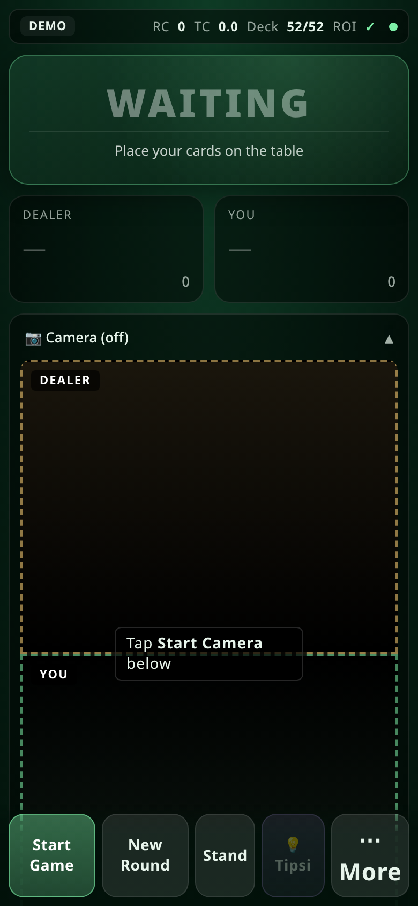
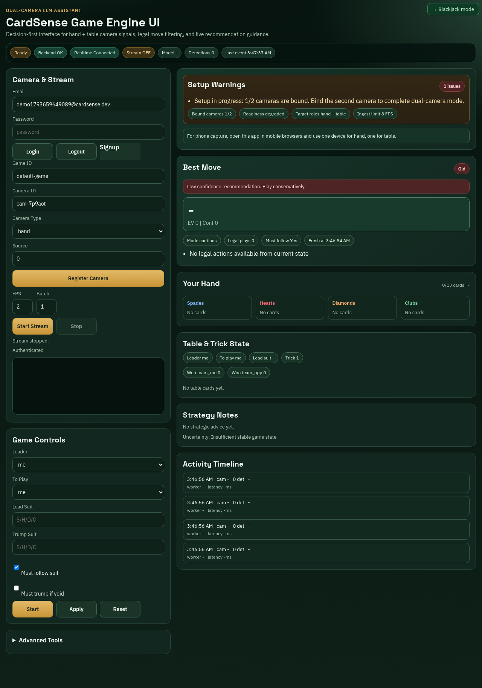
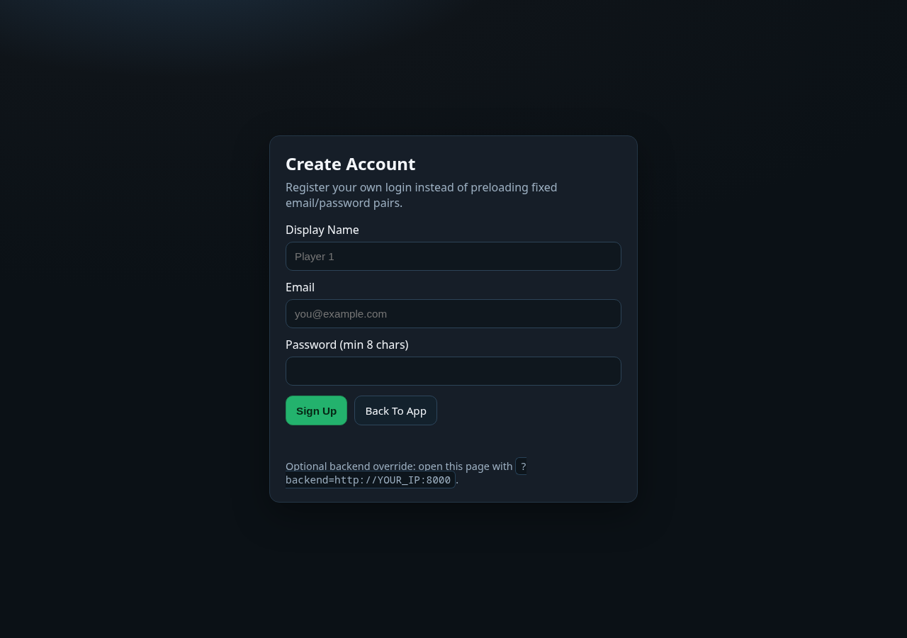
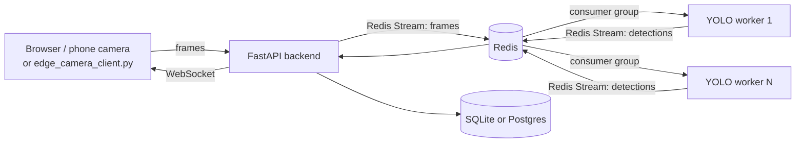

# CardSense

Real-time playing-card detection with live Blackjack advice. Phone or webcam frames go into a queue, parallel YOLO workers detect the cards, and a backend turns detections into game state and a recommended move.

[](https://github.com/Abdul-Wahab-17/CardSense/actions/workflows/ci.yml)



A three-person university project (a Deep Learning course and a Parallel and Distributed Computing course, Spring 2026). See [Credits](#credits).

## What it does

- **Blackjack HUD.** A mobile-first page: point a phone camera at the table, see the dealer's and your cards, and get the basic-strategy move with a running count. Touch-sized buttons for deal, hit, stand, new round.
- **Dual-camera monitor** (the main page). One camera for a hand and one for the table, fused into a single game state, with a legal-move filter and a recommendation for trick-taking card games.
- **Live streaming.** Detections reach the browser over a WebSocket.
- **Optional LLM advisor.** Rules only by default; with an API key it can add explanations, with the rule engine still enforcing legal moves.

| Main page | Sign up |
|---|---|
|  |  |

## Architecture



Frames go through **Redis Streams** and are consumed by a **consumer group** of YOLO workers, so throughput scales by adding workers: `docker compose up --scale worker-service=4`. The backend keeps each game's state, fuses the two camera views, checks moves against the rules and serves the recommendation. See [`docs/operations.md`](docs/operations.md) for scaling, multi-machine setup and troubleshooting.

## Quick start

```bash
cp .env.example .env            # optional: every setting has a default
docker compose up --build
```

Open **http://localhost:8000**, create an account on the sign-up page, sign in, then open **/blackjack.html**. The Blackjack page reuses your session; to skip sign-in on a private machine set `AUTH_ENABLED=0` in `.env`.

The first worker start downloads a public card-detection model from `YOLO_MODEL_URL`. The worker runs on CPU by default; with an NVIDIA GPU use:

```bash
docker compose -f docker-compose.yml -f docker-compose.gpu.yml up --build
```

### Phone camera

Browsers only allow camera access on HTTPS or `localhost`. To use a phone, expose the backend through an HTTPS tunnel (for example `cloudflared tunnel --url http://localhost:8000`) and open `/blackjack.html` on the tunnel URL.

## The detection model

| | |
|---|---|
| **Runs today** | A public playing-card YOLOv8 model (see `YOLO_MODEL_URL`), downloaded on first start. Its accuracy has not been measured here. |
| **The team's model** | Fine-tuned YOLOv8n on a 7,012-image, 52-class dataset. The project report gives **87 % mAP@0.5** on a held-out test split and about **120 ms** from card to recommendation. Those figures are quoted from [the report](docs/reports/CardSense_DL_Project_Report.pdf) and have **not** been reproduced from this repository: the trained weights and dataset are not in it. |
| **Reproduce it** | [`training/train_yolo.py`](training/train_yolo.py) follows the report's recipe (AdamW, cosine learning rate, 50 epochs with early stopping, mosaic off for the last 10 epochs, a glare augmentation, no hue shift). One deviation: the report allows ±180° rotation except for 6s and 9s, but Ultralytics applies one rotation range to every image, so the script uses ±25° for all ranks. Point `--data` at the dataset's `data.yaml`; a GPU is needed. |

To use your own weights, set `YOLO_MODEL=/app/models/best.pt` and mount them in `./models`.

## Configuration

Copy `.env.example` to `.env`. The most useful settings:

| Variable | Default | Purpose |
|---|---|---|
| `AUTH_ENABLED` | `1` | `0` disables login (private demos) |
| `WORKER_PROCESSES` | `1` | YOLO processes per worker container |
| `CONF_THRES` | `0.03` | Detection confidence threshold; lower finds more, with more false positives |
| `YOLO_MODEL`, `YOLO_MODEL_URL` | public model | Which weights the worker loads |
| `YOLO_DEVICE` | `cpu` | `0` for the first GPU (with the GPU compose file) |
| `ADVISOR_MODE`, `LLM_ENABLED`, `LLM_API_KEY`, `LLM_MODEL` | rules / off | Optional LLM advisor |
| `DATABASE_URL` | SQLite | Postgres connection string |

## Tests

```bash
pip install -r requirements.txt
pytest
```

122 tests cover the game-state and fusion engines, the Blackjack engine and ROI logic, the rules and simulator, authentication, event redaction and the autoscaler. Tests that need the YOLO stack (OpenCV, ultralytics, torch) skip themselves when it is not installed; CI installs it. CI also builds both Docker images.

## Project structure

```text
backend/    FastAPI app: state engines, fusion, Blackjack engine, auth, storage
worker/     YOLO inference worker (Redis Streams consumer)
frontend/   React pages served by the backend: monitor, Blackjack HUD, sign-up
training/   reproducible detector training (needs a GPU)
scripts/    edge camera client, start script, smoke tests
docs/       operations guide, project reports and slides
```

## Credits

Built by **Abdul Wahab**, **Rana Muhammad Hammad Arif** and **Muhammad AbuBakar Amjad**. Per the project report:

- **Abdul Wahab:** backend services, Redis Streams integration, worker orchestration and model deployment.
- **Hammad Arif:** dataset construction, annotation QC, augmentation pipeline, training, architecture comparison, ablations and evaluation.
- **AbuBakar Amjad:** frontend HUD, WebSocket integration, camera capture flow and on-device latency profiling.

Project reports and slides are in [`docs/reports`](docs/reports).
